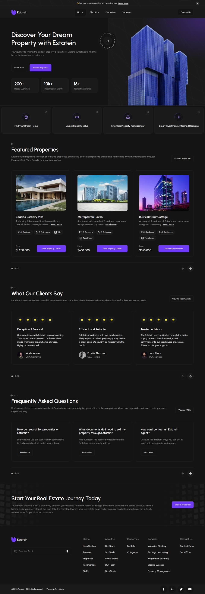
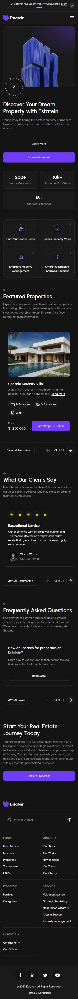
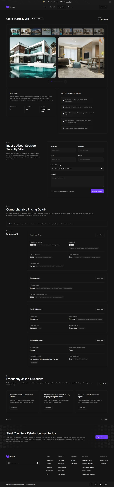
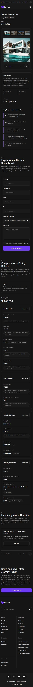

# Estatein – Custom WordPress Theme

Growmodo WordPress Developer assessment by **Khim Fermhee Ronquillo**. The Figma template *"Real Estate Business Website UI Template – Dark Theme"* has been converted into a custom WordPress theme. All six pages are built, responsive from 390 px phones up to 1920 px desktops.

## ▶ Try it online (no setup)

**[Open the live demo in WordPress Playground](https://playground.wordpress.net/?blueprint-url=https://raw.githubusercontent.com/khimfermhee/Growmodo-Application-Wordpress/main/blueprint.json)**

Playground starts a complete WordPress site in your browser. It installs this theme and Secure Custom Fields, then imports all demo content (it takes about 30–60 seconds on first load). The dashboard is at `/wp-admin` and you are already logged in. The copy resets when you close the tab.

**Live site (permanent hosting):** _add your InfinityFree / Wasmer URL here_. See [docs/DEPLOYMENT.md](docs/DEPLOYMENT.md).

## What's inside

| | |
| --- | --- |
| **Pages** | Home · About Us · Properties (with search + filters) · Property Details · Services · Contact Us. There is also a blog (WordPress Loop with a sidebar), an FAQ page, a testimonials page and a 404 page |
| **Content management** | 7 custom post types (Properties, Testimonials, FAQs, Team, Clients, Services, Offices) plus 3 taxonomies. Page sections and a *Theme Settings* page are editable through Secure Custom Fields / ACF field groups registered in PHP |
| **Functionality** | Inquiry, contact and newsletter forms with AJAX, a no-JS fallback and spam protection. Submissions are saved in the dashboard and emailed. Also: carousels, property gallery, office filter, mobile menu, and a one-click demo importer |
| **Quality** | No page builder and no jQuery. ~10 KB CSS and ~3 KB JS gzipped, self-hosted font, responsive images, lazy loading. Accessibility tested with axe-core (no violations), with semantic markup and keyboard support. Meta descriptions, Open Graph tags and JSON-LD for SEO |

## Repository layout

```
├── estatein/            ← the WordPress theme (upload this folder / estatein.zip)
├── docs/
│   ├── DOCUMENTATION.md ← development process, decisions, plugins & tools (1–2 pages)
│   ├── DEPLOYMENT.md    ← step-by-step free hosting guide
│   └── screenshots/     ← desktop + mobile screenshots of every page
└── blueprint.json       ← WordPress Playground setup used by the demo link
```

Theme internals, the content map and build commands are in [estatein/README.md](estatein/README.md).

## Quick install on any WordPress site

1. Upload `estatein.zip` (from **Releases**) under Appearance → Themes → Add New → Upload, then activate it.
2. Install and activate **Secure Custom Fields** (free).
3. Go to Appearance → **Estatein Setup** → **Import demo content**.

## Screenshots

| Desktop | Mobile |
| --- | --- |
|  |  |
|  |  |
